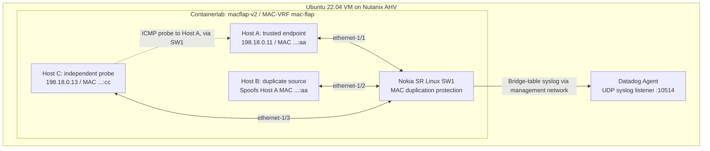
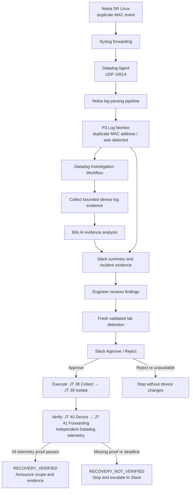
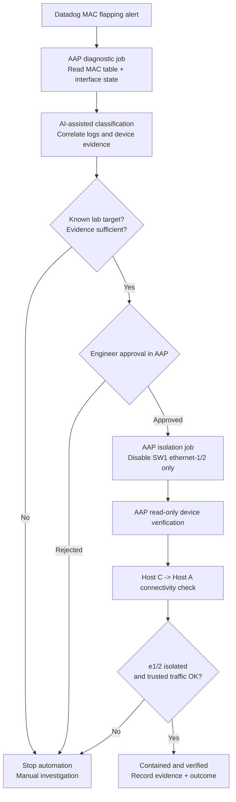

# MAC Flapping AIOps

> **Network AIOps proof of concept:** detect duplicate MAC movement on Nokia SR Linux, investigate the event with Datadog and Bits AI, and extend the workflow toward approval-based Ansible remediation with independent network verification.

This repository combines a **working Datadog detection and investigation configuration** with a separate **Containerlab v2 network lab**. The goal is to demonstrate more than a monitor changing from Alert to OK: the source of the anomaly must be identified, contained, and verified without disrupting the trusted endpoint.

**Important distinction:** a duplicate MAC event is **not automatically proof of a physical Layer 2 loop**. In this controlled lab, Host B is the known duplicate-source endpoint because we deliberately configured it that way.

## Project status

| Component | Status | Notes |
| --- | --- | --- |
| Nokia SR Linux MAC duplication demo (v1) | Validated | MAC movement detected in the prior lab. |
| Datadog log parsing, monitor and read-only investigation | Validated | Real Nokia log samples triggered the workflow, Bits AI summary and Slack notification on Nov 4, 2026. |
| Lab v2 with independent Host C probe | **Built in GitHub, runtime test pending** | New topology and fault generator must be deployed and tested on the Ubuntu VM. |
| AAP evidence collection and port-isolation playbooks | **Code ready, execution pending** | Requires reachable SR Linux management API, AAP credentials and actual Approval node. |
| End-to-end closed-loop remediation | **Not yet validated** | Datadog investigation currently makes **no network changes**. |

## 1. Network architecture: Containerlab v2



- **Host A** is the trusted source, **Host B** generates ongoing duplicate-source traffic, and **Host C** measures forwarding from a separate switch port.
- The traffic generator runs until stopped or its configurable safety time limit expires (default 10 minutes). The simulation stays active while diagnosis and isolation take place.
- SR Linux uses `stop-learning` and a **3-minute hold-down**. New alerts can pause even while Host B continues sending packets. Lack of logs alone is therefore **not a recovery signal**.
- All spoofed traffic must remain on the isolated lab data plane. Do not attach the experiment to production networks.

Implementation: [lab-v2 topology and scripts](lab-v2/README.md) · [Migration from v1](lab-v2/docs/MIGRATE-FROM-V1.md)

## 2. Current Datadog architecture: detection and investigation

The v2 syslog, parser, monitor, Bits agent summary and Slack delivery were verified on Nov 6. The workflow now adds an approval decision with an inactive AAP placeholder; no device action is connected.



The query matches **detection events** and excludes generic `DATADOG_SYSLOG_TEST` entries and `is now deleted` messages. Nokia's `sr_l2_mac_mgr` may be the reserved `service`, while `service:nokia-srlinux` appears in log tags. See the exported monitor rather than replacing it with a broad `service:` search.

**Validated evidence (Nov 4, 2026):** the stored snapshot reports four parsed Nokia log variants, a triggered log monitor, a completed read-only investigation classified as `MAC_FLAPPING_EVIDENCE`, and a Slack delivery. This does **not** mean the v2 topology or AAP remediation has already passed.

[Datadog workflow run](https://app.datadoghq.com/workflow/beb71b61-bff9-460d-ad37-853ae9cc778e?instance=1f909fed-cf5f-46dd-a4ab-a3217adf4f63) · [Datadog runbook](https://app.datadoghq.com/notebook/16202843)

**Nov 6 update:** the published workflow uses the custom Bits agent with bounded log evidence and chronological clear-event validation. Native Bits Investigation is no longer started automatically. Slack follows the existing POC INCIDENT RESPONSE format, with evidence, limitations, and read-only next checks. See [workflow behavior and verification](lab-v2/docs/BITS-INVESTIGATION.md). Fresh validated monitor detections now request Approve/Reject in #datadog-automation. The Nov 8 publication connects Approve to fixed AAP JT 38 → 39 → 40 → 41. JT39 can disable sw1 ethernet-1/2 after approval. The bounded Datadog verifier can report RECOVERY_VERIFIED for containment/forwarding with matched log clearance and a five-minute quiet observation; missing proof stops and escalates. See [exact verifier policy](lab-v2/docs/TELEMETRY-VERIFIER.md). See [recovery stages](lab-v2/docs/RECOVERY-WORKFLOW.md).

## 3. Target architecture: investigation, approval, remediation and verification

The following is the **intended integration**, **not the current automatically connected workflow**.



**Safety controls:** the playbook explicitly allowlists `sw1` and `ethernet-1/2`. It must run through AAP RBAC and a real Approval step; a `change_approved: true` extra variable alone is not authorization. Isolation only blocks the known duplicate-source lab port and is not a generic production mitigation recommendation.

**Recovery proof requires all three**: (1) device reports `ethernet-1/2` disabled, (2) Host C can still reach trusted Host A, and (3) duplicate-MAC / MAC-table state is checked after the hold-down stabilizes. Monitor OK after five quiet minutes is **insufficient**.

## 4. Quick start: move from v1 to v2

```bash
# On the Ubuntu Containerlab VM
cd ~/mac-flapping-lab
sudo containerlab save -t macflap.clab.yml
tar czf ~/macflap-v1-backup.tgz .

# Stop the v1 fault generator before destroying the v1 topology.
sudo containerlab destroy -t macflap.clab.yml

cd ~
git clone https://github.com/avecenabasuni/mac-flapping-aiops.git
cd mac-flapping-aiops/lab-v2

sudo docker build -t macflap-endpoint:v2 -f endpoint/Dockerfile .
sudo containerlab deploy -t macflap-v2.clab.yml
sudo containerlab inspect -t macflap-v2.clab.yml

chmod +x scripts/*.sh
./scripts/probe.sh 10                # Healthy baseline: Host C -> Host A
./scripts/run-continuous.sh          # Inject duplicate MAC continuously
```

Use a separate terminal for `./scripts/probe.sh 20` and for the SR Linux CLI:

```bash
sudo docker exec -it clab-macflap-v2-sw1 sr_cli
```

```text
show network-instance mac-flap bridge-table mac-duplication duplicate-entries
show network-instance mac-flap bridge-table mac-table all
show interface ethernet-1/2
```

**Before connecting AAP**, confirm that its execution environment can reach the Nokia management API and the Ubuntu VM. Docker management IPs are not necessarily routable from a separate AAP VM. See the [full migration guide](lab-v2/docs/MIGRATE-FROM-V1.md) and [AAP setup](lab-v2/ansible/README.md).

## 5. Repository structure

```text
mac-flapping-aiops/
├── README.md
├── datadog/
│   ├── monitors/             # P3 MAC duplication log alert
│   ├── pipelines/            # Nokia detection/deletion log parsing
│   ├── workflows/            # Read-only investigation and scenario controller
│   ├── agents/               # Bits AI evidence analyst
│   └── manifest.json         # Export metadata and validation summary
└── lab-v2/
    ├── macflap-v2.clab.yml   # Three hosts + Nokia SR Linux switch
    ├── sw1.cfg               # MAC-VRF and duplication detection
    ├── endpoint/             # Linux image + ARP frame generator
    ├── scripts/              # Continuous injection, probe, status
    ├── ansible/              # Evidence, isolation, verification, rollback
    └── docs/                 # Migration, Datadog integration, demo runbook
```

| Document / artifact | Purpose |
| --- | --- |
| [Lab v2 README](lab-v2/README.md) | Deploy, inspect and exercise the new topology. |
| [Live demo runbook](lab-v2/docs/DEMO-RUNBOOK.md) | Presenter flow, expected evidence, contingencies and rollback. |
| [v1 → v2 migration](lab-v2/docs/MIGRATE-FROM-V1.md) | Back up and preserve the old lab. |
| [AAP integration](lab-v2/ansible/README.md) | Credentials, JSON-RPC, approval, device and forwarding verification. |
| [Datadog integration](lab-v2/docs/DATADOG.md) | v2 Syslog forwarding and existing monitor reuse. |
| [Switch and lab device monitoring](lab-v2/docs/DEVICE-MONITORING.md) | SNMP Agent/CLI templates, monitoring scope, and telemetry acceptance checks. |
| [Full lab monitoring package](lab-v2/docs/FULL-LAB-MONITORING.md) | Ubuntu + four containers + switch interfaces + forwarding probe, 19 draft monitors and dashboard JSON. |
| [MAC flapping monitor](datadog/monitors/network-mac-flapping.json) | P3 query, thresholds and notification message. |
| [Investigation workflow](datadog/workflows/investigate-network-mac-flapping.json) | Bounded log collection, Bits AI summary and Slack. |
| [Bits agent workflow and timeline validation](lab-v2/docs/BITS-INVESTIGATION.md) | Bounded custom-agent analysis, chronological clear-event checks, POC Slack messages, and verification evidence. |
| [Scenario controller](datadog/workflows/operational-scenario-controller-v6-aap.json) | Existing AAP scenarios; MAC-flapping scenarios are placeholders. |
| [Sanitized export manifest](datadog/manifest.json) | Deployed source IDs and stored validation results. |

## 6. Datadog export notes and current limits

- Datadog files are **sanitized exports**, not a turn-key deployment. Replace account-specific connection, Slack, AAP and workflow references when importing elsewhere. Keep credentials in Datadog Connections/AAP credentials, never Git.
- Existing scenario controller choices include `pool`, `disk`, `autoscale`, `rollback`, `memory`, `reset-memory` and `reset`. The new `mac-flapping` / `reset-mac-flapping` choices currently resolve to `JOB_NOT_CONFIGURED`: **no AAP job is launched**.
- The current Datadog investigation workflow is **read-only** and **does not change Nokia configuration**.
- The existing investigation has a maximum 100-log sample, a 60-second monitor-trigger rate limit, and no cross-run deduplication.
- **Network recovery is not validated** merely because a log message is deleted, a hold-down expires or a monitor returns to OK.

## 7. Demo objective

**Detect → Investigate → Approve → Isolate → Verify.**

Keep Host B's duplicate-source generator running throughout the demonstration, show the approved change to `ethernet-1/2`, and independently verify that Host A remains reachable through Host C. Only claim full remediation after these outcomes are observed on the actual running lab.
