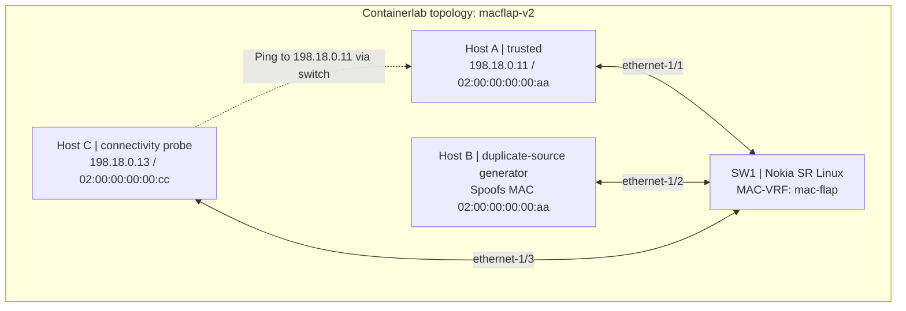
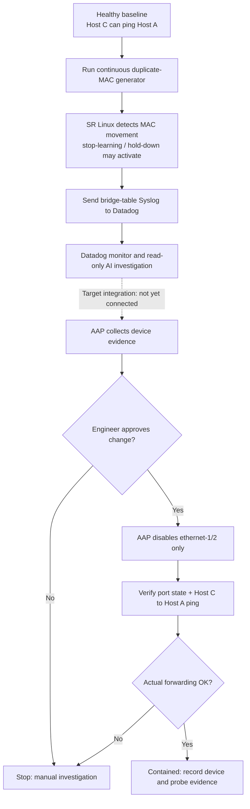

# Containerlab v2: MAC Flapping and Verified Network Containment

This directory provides the **runnable network lab** for the standalone [MAC Flapping AIOps project](../README.md). It adds an independent Host C probe, continuous duplicate-source traffic and Ansible playbooks for controlled port isolation.

> **Runtime status:** v2 configuration has been committed but is **not yet validated on the Ubuntu/Nutanix host**. The older v1 lab and stored Datadog detection/investigation workflow are separate from v2 deployment.

## Network topology



**Data plane:** all endpoint traffic is isolated inside the Containerlab links. Host B repeatedly injects frames claiming Host A's source MAC; Host C measures whether Host A remains reachable.

**Management plane:** Datadog Agent runs on the Ubuntu host and listens for Nokia bridge-table Syslog on UDP 10514. Ansible AAP must be able to reach Nokia's management API, and the forwarding verification job needs SSH/Docker access to the Ubuntu host. These two paths are not automatically reachable from another VM.

## Fault injection and response flow



The **solid diagram path through Datadog investigation** reflects the previously tested detection configuration; the **dashed connection to AAP** is a planned integration. The new v2 topology, the AAP job execution, and the complete chain must be independently tested.

### Why the forwarding probe matters

The SR Linux configuration uses `num-moves 3`, a 1-minute monitoring window, `action stop-learning` and a **3-minute hold-down**. The log monitor returning to OK simply means there were no new matching detections in its last 5-minute window. It does **not** show that the duplicate-source ingress has been isolated or that trusted connectivity is healthy.

For successful containment, demonstrate:

1. Host B's traffic generator is **still running**.
2. `ethernet-1/2` is administratively **disabled** following approved AAP action.
3. Host C gets a successful ICMP response from Host A (target: zero loss over the independent verification sample).
4. MAC-VRF state and duplication protection are checked after the hold-down settles.

## Step 1: Build and deploy

On the Ubuntu Containerlab VM:

```bash
cd ~/mac-flapping-aiops/lab-v2

sudo docker build -t macflap-endpoint:v2 -f endpoint/Dockerfile .
sudo containerlab deploy -t macflap-v2.clab.yml
sudo containerlab inspect -t macflap-v2.clab.yml

chmod +x scripts/*.sh
./scripts/status.sh
```

Expected containers: `clab-macflap-v2-sw1`, `clab-macflap-v2-host-a`, `clab-macflap-v2-host-b`, `clab-macflap-v2-host-c`.

## Step 2: Prove the healthy baseline

```bash
./scripts/probe.sh 10
```

**Expected:** Host C reaches Host A, ideally with 0% packet loss before fault injection. If not, troubleshoot the MAC-VRF, interface state and endpoint addresses *before* triggering the fault.

## Step 3: Inject the continuous MAC duplication fault

In **Terminal A**:

```bash
./scripts/run-continuous.sh

# Optional: set a 20-minute lab safety limit (default is 10 minutes)
MAX_SECONDS=1200 ./scripts/run-continuous.sh
```

Only run **one** instance of the generator at a time. Press Ctrl+C to stop it. Host B keeps sending duplicate-MAC traffic even if its switch port has been administratively disabled; that is how the post-remediation demonstration proves containment.

In **Terminal B**, check the legitimate forwarding path during the fault:

```bash
./scripts/probe.sh 20
```

In **Terminal C**, inspect the Nokia switch:

```bash
sudo docker exec -it clab-macflap-v2-sw1 sr_cli
```

```text
show network-instance mac-flap bridge-table mac-duplication duplicate-entries
show network-instance mac-flap bridge-table mac-table all
show interface ethernet-1/2
```

There may be no packet loss during the fault, and additional duplicate detection logs may be suppressed by the device hold-down. Report measured results rather than assuming degradation.

## Step 4: Connect Datadog and AAP

The repository already includes saved Datadog exports in [../datadog](../datadog), including a log monitor, parsing pipeline, read-only investigation workflow and Bits AI evidence analyst. **Do not create duplicate monitors by default.** Follow the [v2 Datadog guide](docs/DATADOG.md) to configure v2's own Syslog forwarding and validate a real v2 detection.

AAP playbooks live in [ansible](ansible/README.md):

| Playbook | Purpose |
| --- | --- |
| `collect-evidence.yml` | Read MAC table and interface evidence. |
| `isolate-b.yml` | Approval-gated isolation of **e1/2 only**. |
| `verify.yml` | Read interface/MAC-VRF state after remediation. |
| `verify-forwarding.yml` | From Ubuntu SSH, run Host C to Host A ICMP probe. |
| `restore-b.yml` | Manual approved rollback to enable e1/2. |

The approval gate is an **AAP Workflow Approval node** controlled by authorization/RBAC; an extra variable is a sanity check, not a substitute for authorization.

## Cleanup and rollback

Stop Terminal A generator. If necessary, manually restore `ethernet-1/2` with the approved AAP restore job. To stop only v2:

```bash
sudo containerlab destroy -t macflap-v2.clab.yml
```

Do not destroy v1 topology files or use `--cleanup` while you are keeping lab backups.

## Further reading

- [Architecture and overview](../README.md)
- [Migration from v1](docs/MIGRATE-FROM-V1.md)
- [Live demo runbook](docs/DEMO-RUNBOOK.md)
- [Datadog integration](docs/DATADOG.md)
- [AAP implementation](ansible/README.md)
